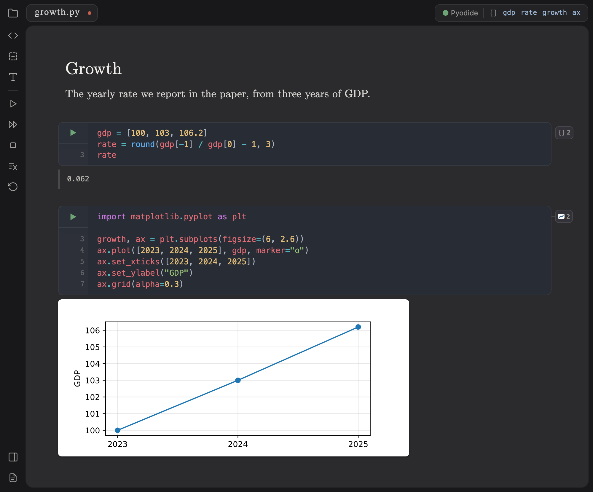
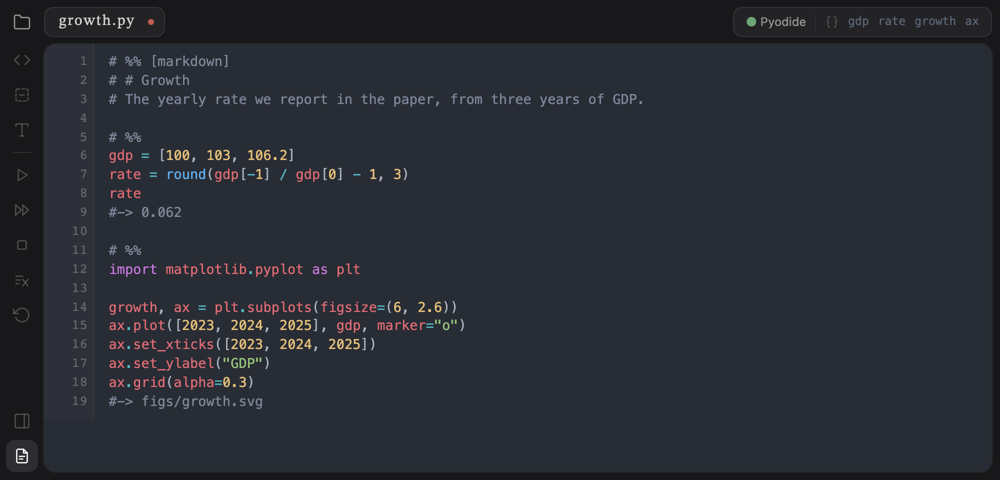
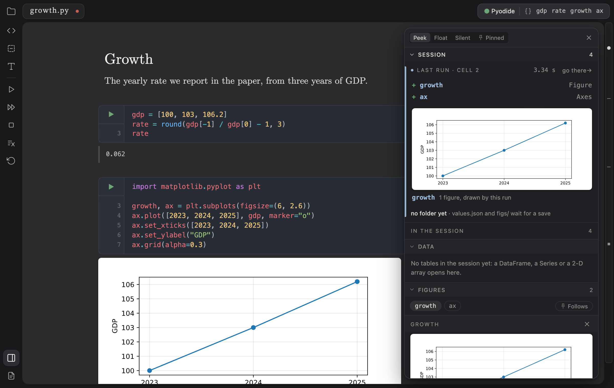

# Knuth

Knuth is a notebook for Python that saves plain `.py` files. You write in
cells, run them against a live Python session, and see the results under
each cell. The file stays a Python script anyone can run.

Try it in your browser: **<https://knuth.tayweid.io>**

<p align="center">
  
</p>

## Why

Jupyter notebooks are JSON: they diff badly and can't be run with
`python`. Plain scripts lose the cells, the outputs and the live session.

Knuth keeps the script. Cells are marked with `# %%`, which VS Code,
Spyder and PyCharm already understand, and outputs are saved as comments,
so git shows a changed result beside the code that changed it.

Knuth is the computing half of a pair; [Plass](https://github.com/tayweid/plass)
is the writing half. Knuth puts the numbers and figures you name into the
project folder, and the paper reads them from there.

## Install the Mac app

Paste this into Terminal:

```sh
curl -fsSL https://knuth.tayweid.io/install | bash
```

This puts Knuth in Applications. Run the same line again to update. Needs
macOS 13 or later.

The first time you open it, Knuth asks whether to install Python. **Yes**
gets a Python of Knuth's own through [uv](https://docs.astral.sh/uv/)
(about 60 MB, once), leaving anything already on your Mac alone. **Not
now** runs Python inside the window with [Pyodide](https://pyodide.org):
the common packages work, but it needs the network and documents aren't
reproducible. Change it later under **Knuth → Choose Python…**.

To have `.py` and other code files open in Knuth when you double-click
them, choose **Knuth → Make Knuth the Default Editor…**.

### Windows, Linux, or the terminal

Knuth also runs as a local web page, served by a Python package:

```sh
python3 -m pip install --upgrade --force-reinstall "knuth @ https://github.com/tayweid/knuth/archive/refs/heads/main.zip#subdirectory=python"
knuth app ~/my-project
```

On Windows, use `py` in place of `python3`. `knuth app` opens Knuth in
your browser, working in that folder. Keep the terminal open; Ctrl-C
stops it. If it won't connect, run `knuth doctor`.

## Your files

A Knuth document looks like this on disk:

```python
# %% [markdown]
# # Growth
# The yearly rate we report in the paper.

# %%
gdp = [100, 103, 106.2]
rate = round(gdp[-1] / gdp[0] - 1, 3)
rate
#-> 0.062

# %% scratch
#| sum(gdp) / len(gdp)
```

There are three kinds of cell:

- **Code cells** (`# %%`) are your program.
- **Text cells** (`# %% [markdown]`) are notes in Markdown, with math in
  `$…$`. You edit them as formatted text, not as comments.
- **Scratch cells** (`# %% scratch`) are for poking at things. They're
  saved commented out (`#|`), so `python analysis.py` skips them.

Lines starting `#->` are saved output, written by Knuth. ⌘⇧E switches
to the file itself, outputs and all:



Code runs in the project folder, so `pd.read_csv("data.csv")` finds the
file beside it. Knuth saves as you type; **Autosave**, under Open's
chevron, turns that off for one document, and a Save button shows beside
its name.

Have notebooks? Open a `.ipynb` and Knuth turns it into a new `.py` beside
it, leaving the notebook alone. `knuth import *.ipynb` does a whole folder
at once.

## Values and figures

When a code cell runs, Knuth writes what it named into the document's
folder:

- Numbers, strings, lists and dicts go into `values.json`.
- A matplotlib figure goes to `figs/` under its name:
  `growth, ax = plt.subplots()` makes `figs/growth.svg`.

Underscore names and scratch cells are left out. A paper in Typst or Plass
reads these files directly, so the whole build is one line, with neither
app open:

```sh
knuth run analysis.py && typst compile paper.typ
```

`knuth run` is the check that your document really works. It starts a
fresh Python, runs the code cells top to bottom, stops at the first error,
and rewrites the outputs and `values.json`. Scratch cells don't run.

Click the pill at the top right to see everything the session holds.
DataFrames open in a table you can scroll; figures open full size.



## Packages

A document can list its own packages in a standard header at the top
([PEP 723](https://peps.python.org/pep-0723/)):

```python
# /// script
# requires-python = ">=3.13"
# dependencies = [
#     "pandas==2.3.2",
# ]
#
# [tool.uv]
# exclude-newer = "2026-09-26T00:00:00Z"
# ///
```

You rarely type this. With uv's Python, when a cell imports something the
document doesn't list, Knuth adds it at an exact version and runs the cell
again, asking first if it needs a download. The date line holds
everything underneath, so the file installs the same way years from now.

The header is only comments, so the file still runs elsewhere:
`uv run analysis.py` builds the environment and runs it, and
`knuth env analysis.py` prints the Python to point VS Code or Spyder at.
More in [ENVIRONMENT.md](./docs/ENVIRONMENT.md).

## Other files

Knuth opens more than notebooks:

- **CSV and TSV** open as a table you can edit.
- **Excel** workbooks (`.xlsx`) open read-only, one sheet at a time. Save
  a sheet as CSV to edit it. This needs Python on your computer, not
  Pyodide.
- **Code and text** in about a hundred other languages (Markdown, R,
  Julia, LaTeX, JSON, shell, …) open in a plain editor with highlighting.

## History

In the Mac app, **History** (⇧⌘H) shows the project as it was at each
run, and every minute in between. Go back to any point and carry on.

It's kept with git, on a branch of its own (`claerbout-autosave`). Your
branches and commits are never touched and nothing is pushed. A project
folder that isn't a git repository yet becomes one, except your home
folder, Desktop, Documents, Downloads and cloud-synced folders themselves.
Files in an `untracked/` folder are left out. More in
[AUTOSAVE.md](./docs/AUTOSAVE.md).

## Keys

| Keys | Does |
| --- | --- |
| ⇧⏎ | Run the cell and go to the next one |
| ⌘⏎ | Run the cell and stay |
| ⌥⏎ | Run the cell and add a new one below |
| ⌘⇧⏎ | Add a cell below without running |
| Esc, then S / M / Y | Make the cell scratch / text / code |
| Esc, then O | Clear the cell's output |
| Ctrl-Space | Complete a name from the live session |
| ⌘⇧E | Switch between cells and the plain file |
| ⌘S / ⌘O | Save / open |
| ⇧⌘H | History (Mac app) |

The buttons down the left side add cells, run everything, re-run only
what your edits made out of date, and stop.

## The command line

| Command | Does |
| --- | --- |
| `knuth app [folder or file]` | Start Knuth and open it in the browser |
| `knuth run file.py` | Run the document fresh and rewrite its outputs |
| `knuth env file.py` | Build the document's packages, print its Python |
| `knuth import a.ipynb …` | Turn notebooks into `.py` documents |
| `knuth doctor` | Report versions and whether Knuth is running |
| `knuth serve` | Run Knuth in the foreground, without opening a browser |
| `knuth agent install` | On a Mac, keep Knuth running in the background |

## Status

Knuth is a preview, built and kept up by one person. Keep your documents
in git or another backup. Report bugs as GitHub issues and security
problems privately ([SECURITY.md](./docs/SECURITY.md)).

Knuth runs your Python with your permissions. It is not a sandbox, so
only open documents you'd run yourself.

## Working on Knuth

```sh
npm install
npm run dev                  # http://localhost:5198
npm test
npm run test:browser         # after: npx playwright install chromium

python3 -m venv .venv && .venv/bin/pip install -e 'python[test]'
.venv/bin/knuth serve        # the engine; the dev page reaches it through vite
.venv/bin/python -m pytest python/tests
```

`npm run app` runs the Mac app from the checkout, beside an installed one.
`npm run install:local` installs the checkout's build as Knuth.app.
`npm run screenshots` (with the dev server running) retakes the pictures
in this README.

Design notes are in [docs/](./docs): [DESIGN.md](./docs/DESIGN.md) (the
file format), [SAME_ORIGIN.md](./docs/SAME_ORIGIN.md) (how the page
reaches Python safely), [APP.md](./docs/APP.md) (the Mac app) and
[ROADMAP.md](./docs/ROADMAP.md) (what's next).

## The name

Knuth is named for Donald Knuth, whose literate programming mixed prose
and code in one file. It's part of the Claerbout family, named for Jon
Claerbout, who argued that a paper should ship with the code that
reproduces it.

## License

[MIT](./LICENSE) © 2026 Taylor J Weidman
